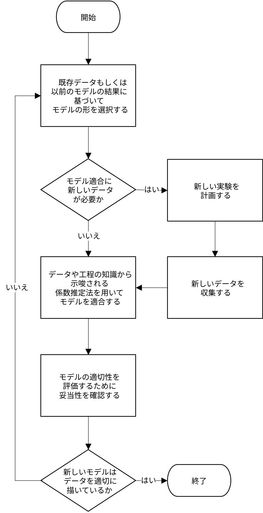

[原文 (Original English)](https://www.itl.nist.gov/div898/handbook/toolaids/eq/eq2.htm)  
閲覧(UTC)：2026-11-16 12:41:47  
[⬅️️](eq1.md)[➡️](eq3.md)

[ツールとお役立ち](../../toolaids.md)  
[工学に関する質問](index.md)

---

#  上司から新しい工程データに対して回帰モデルを作成するよう依頼されましたが、基本的な手順は何でしょうか？

---

#### 訳註

* 翻訳版は、フローチャート要素のリンクが無効化されています。以下のリンクをお試しください。

    1. [既存データもしくは以前のモデルの結果に基づいてモデルの形を選択する](../../ch4_pmd/section4/pmd42.md)
    2. [データや工程の知識から示唆される係数推定法を用いてモデルを適合する](../../ch4_pmd/section4/pmd43.md)
    3. [グモデルの適切性を評価するために妥当性を確認する](../../ch4_pmd/section4/pmd44.md)
    4. [新しいモデルはデータを適切に描いているか](../../ch4_pmd/section4/pmd44.md)
