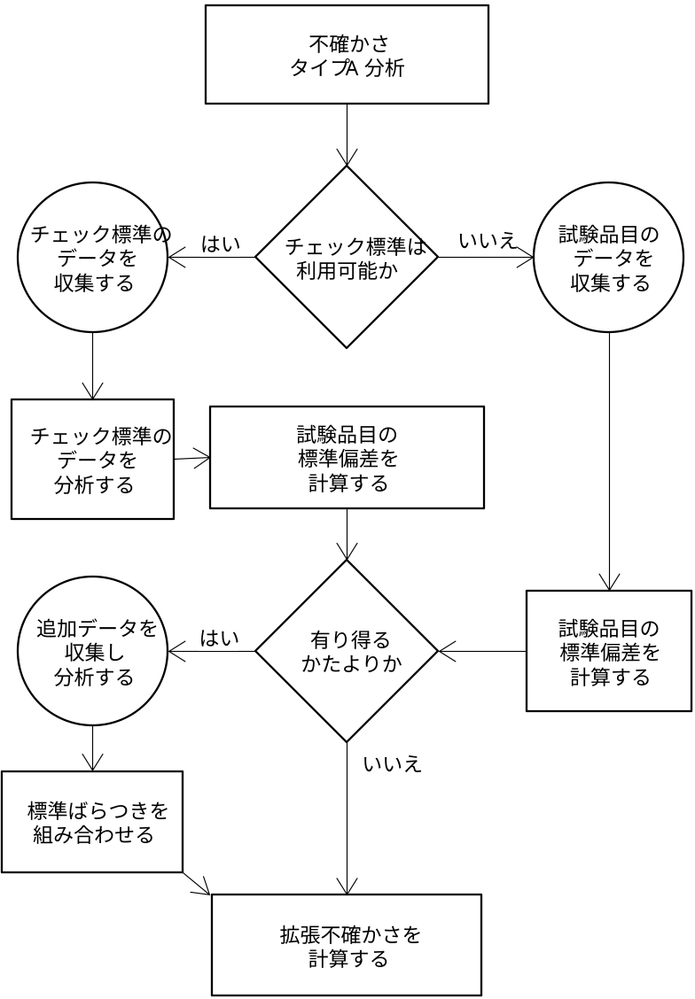

[原文 (Original English)](https://www.itl.nist.gov/div898/handbook/toolaids/eq/eq3.htm)  
閲覧(UTC)：2026-11-17 00:00:00    
[⬅️️](eq2.md)[➡️](eq4.md)  

[ツールとお役立ち](../../toolaids.md)  
[工学に関する質問](index.md)

---

**質問：** 施設内の測定器間に差異の可能性がある、試験片の測定に関して、単純な不確かさ分析方法はありますか？

**回答：** フローチャートの最初の部分で測定の繰り返し性を分析する2つの代替手法が示されています。ゲージ間の差異を検定するには、偏りに関する質問へ行ってください。

---

#### 訳註

* 翻訳版は、フローチャート要素のリンクが無効化されています。以下のリンクをお試しください。

    1. [不確かさタイプA 分析](../../ch2_mpc/section5/mpc53.md)
    2. [チェック標準は利用可能か](../../ch2_mpc/section1/mpc12.md)
    3. [チェック標準のデータを収集する](../../ch2_mpc/section1/mpc122.md)
    4. [チェック標準のデータを分析する](../../ch2_mpc/section2/mpc23.md)
    5. [試験品目の標準偏差を計算する](../../ch2_mpc/section5/mpc562.md)
    6. [試験品目のデータを収集する](../../ch2_mpc/section5/mpc561.md)
    7. [試験品目の標準偏差を計算する](../../ch2_mpc/section5/mpc561.md)
    8. [有り得るかたよりか](../../ch2_mpc/section5/mpc531.md)
    9. [追加データを収集し分析する](../../ch2_mpc/section5/mpc5312.md)
    10. [標準ばらつきを組み合わせる](../../ch2_mpc/section5/mpc56.md)
    11. [拡張不確かさを計算する](../../ch2_mpc/section5/mpc57.md)
