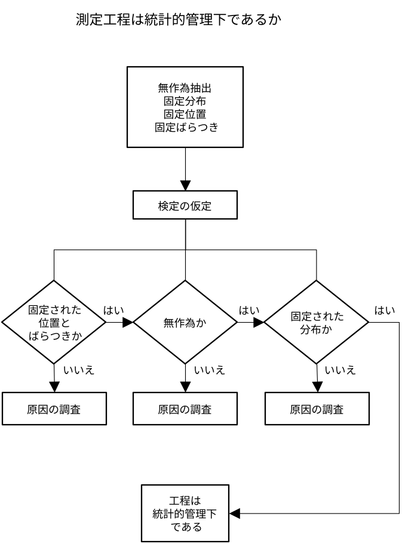

[原文 (Original English)](https://www.itl.nist.gov/div898/handbook/toolaids/eq/eq4.htm)  
閲覧(UTC)：2026-11-17 00:00:00    
[⬅️️](eq3.md)[➡️](eq5.md)  

[ツールとお役立ち](../../toolaids.md)  
[工学に関する質問](index.md)

---

# 測定工程は統計的管理下であるか

#### 測定工程が統計的管理下であるかの判断

---

#### 訳註

* 翻訳版は、フローチャート要素のリンクが無効化されています。以下のリンクをお試しください。

    1. [無作為抽出/固定分布/固定位置/固定ばらつき](../../ch1_eda/section2/eda21.md)
    2. [検定の仮定](../../ch1_eda/section2/eda23md)
    3. [固定された位置とばらつきか](../../ch1_eda/section3/eda33p.md)
    4. [無作為か](../../ch1_eda/section3/eda33f.md)
    5. [固定された分布か](../../ch1_eda/section3/eda33emd)
    6. [原因の調査](../../ch2_mpc/section5/mpc561.md)
    7. [原因の調査](../../ch2_mpc/section5/mpc561.md)
    8. [原因の調査](../../ch2_mpc/section5/mpc531.md)
    9. [工程は統計的管理下である](../../ch1_eda/section2/eda22md)

